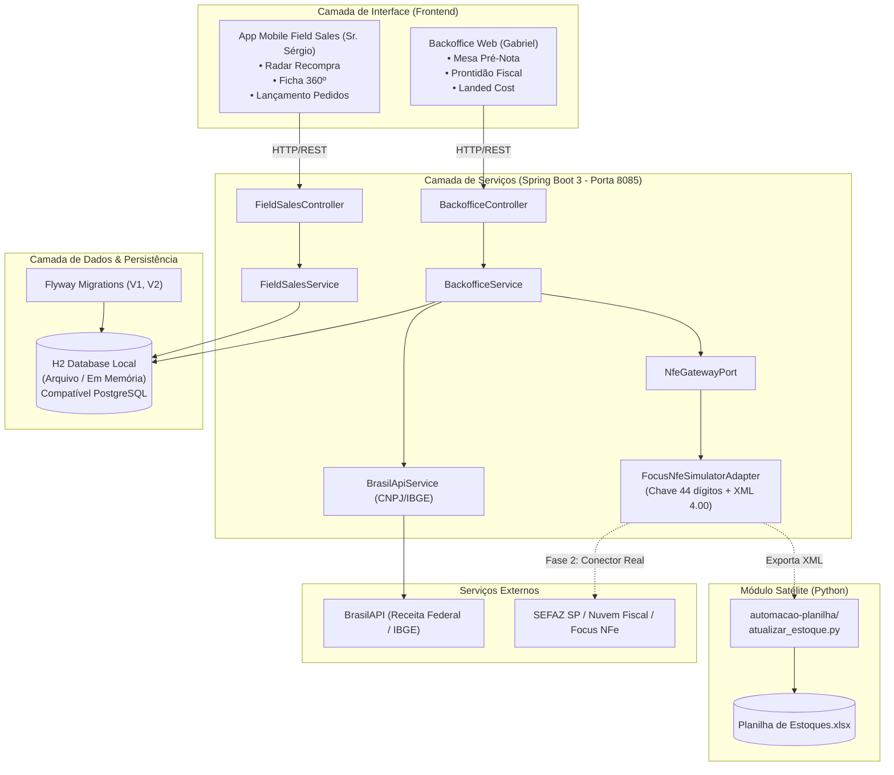
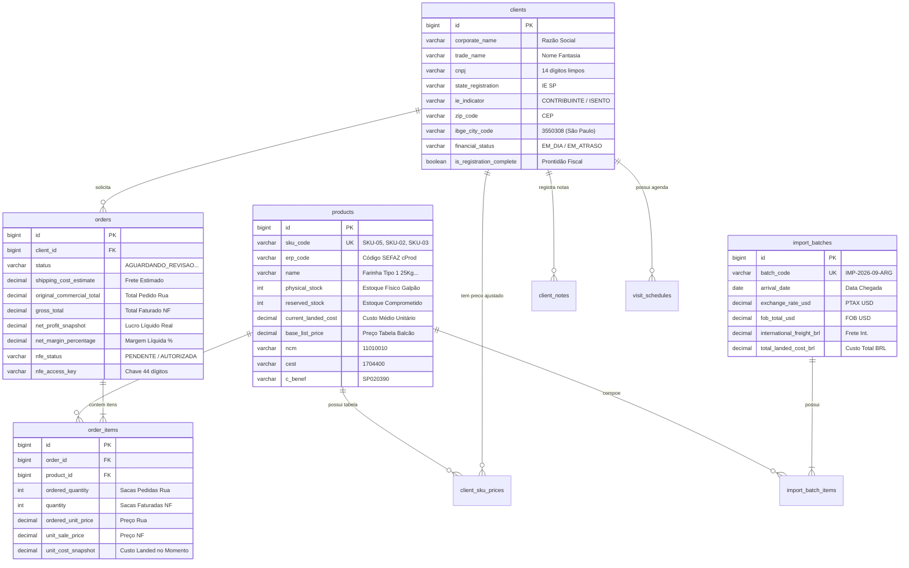
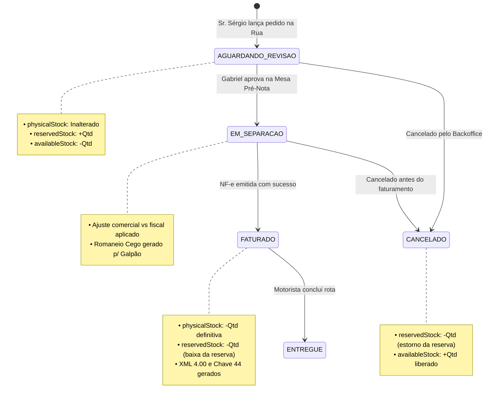

# 🏗️ Arquitetura do Sistema e Engenharia de Software — TotalTrigo ERP

Este documento descreve a arquitetura técnica, o modelo de domínio, os fluxos de integração e a infraestrutura de dados da plataforma integrada **TotalTrigo ERP**.

---

## 🏛️ Visão Geral da Arquitetura

O ecossistema TotalTrigo é composto por três camadas complementares:

1. **Backend REST API**: Construído em **Java 21** e **Spring Boot 3.4**, aplicando padrões de Arquitetura Limpa / Hexagonal (Ports & Adapters), controle transacional rígido e migrações versionadas com **Flyway**.
2. **Frontend SPA / PWA Ready**: Desenvolvido em **React 18**, **TypeScript**, **Vite** e **Tailwind CSS**, oferecendo duas interfaces responsivas: o *App de Vendas de Campo (Mobile)* para o Sr. Sérgio e a *Mesa de Conferência Pré-Nota (Desktop)* para o Gabriel.
3. **Módulo Autônomo de Automação de Planilha**: Módulo em **Python 3** desacoplado que opera de forma local e offline para processamento batch de NF-e e atualização da `Planilha de Estoques.xlsx`.

---

## 💾 Modelo de Dados e Entidades (ERD)

A base de dados é estruturada para garantir a rastreabilidade total desde o lote de importação até a emissão da NF-e e entrega na padaria:

---

## 🔄 Máquina de Estados do Pedido e Estoque Triplo

Um dos diferenciais de engenharia do sistema é o **Controle Triplo de Estoque**, que impede vendas descobertas e garante que nenhum saco de trigo saia do galpão sem reserva prévia:

### Variáveis de Estoque por SKU
$$\text{availableStock} = \text{physicalStock} - \text{reservedStock}$$

### Transições de Estado

---

## ⚡ Integrações Externas

### 1. BrasilAPI (Autocompletar de CNPJ e Resolução IBGE)
* **Endpoint de CNPJ**: `https://brasilapi.com.br/api/cnpj/v1/{cnpj}`
  * Extrai Razão Social, Nome Fantasia, Logradouro, Número, Bairro, CEP e Município.
* **Endpoint de Municípios IBGE**: `https://brasilapi.com.br/api/ibge/municipios/v1/{uf}`
  * Obtém o código IBGE oficial de 7 dígitos (ex: `3550308` para São Paulo), campo obrigatório para transmissão de NF-e na SEFAZ.

### 2. Gerador Fiscal NF-e 4.00 (`FocusNfeSimulatorAdapter`)
O adapter gera a chave de acesso oficial de 44 dígitos calculada com o dígito verificador módulo 11 conforme o Manual de Orientação do Contribuinte (MOC):
$$\text{Chave} = \text{UF}(35) + \text{AAMM}(2610) + \text{CNPJ}(09265201000195) + \text{Mod}(55) + \text{Série}(001) + \text{nNF}(9) + \text{tpEmis}(1) + \text{cNF}(8) + \text{cDV}(1)$$
O XML emitido é 100% compatível com a estrutura de validação da SEFAZ e com o leitor Python `nfe_parser.py`.
