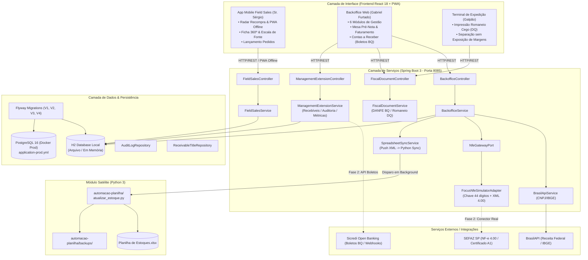
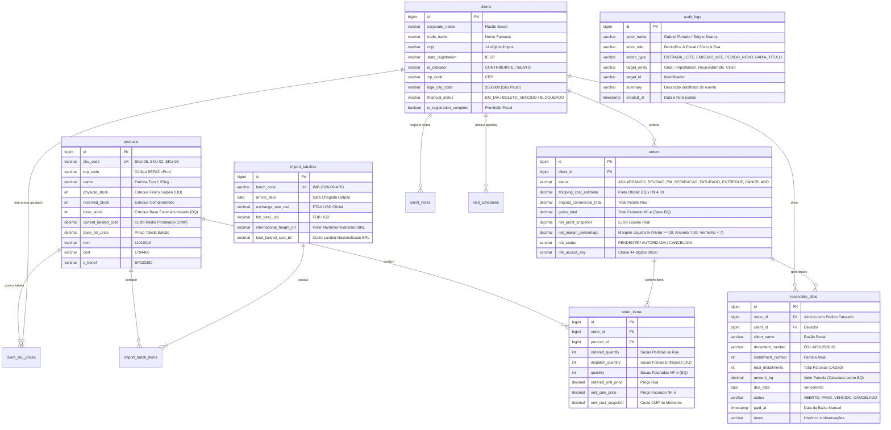
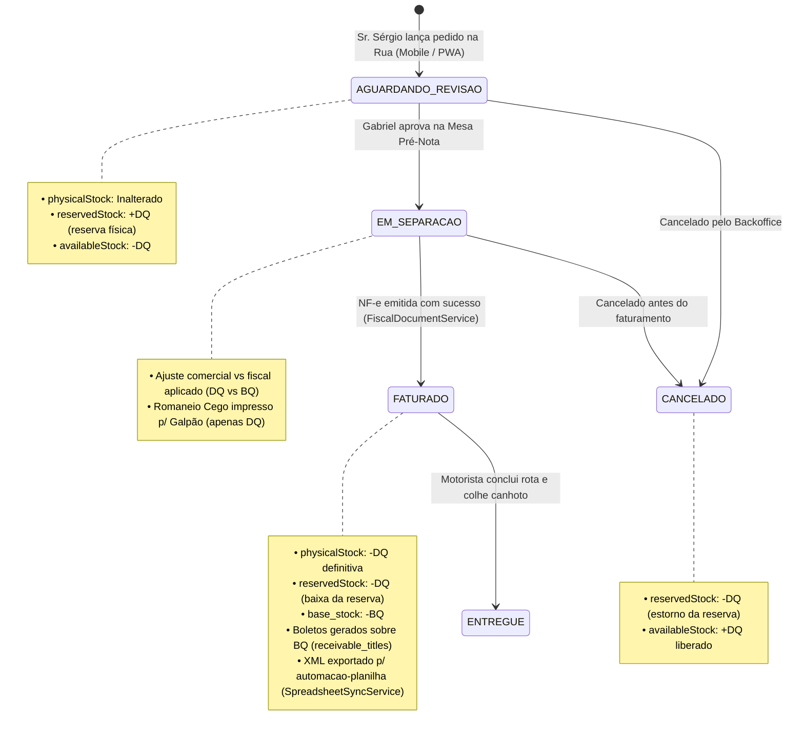
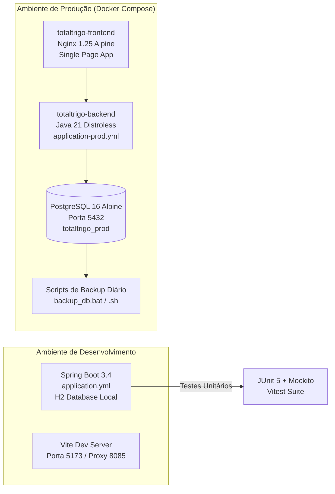

# 🏗️ Arquitetura do Sistema e Engenharia de Software — TotalTrigo ERP

Este documento descreve a arquitetura técnica, o modelo de domínio com dupla quantidade e duplo estoque (DQ/BQ), os fluxos de integração fiscal e bancária, e a infraestrutura de dados da plataforma integrada **TotalTrigo ERP**.

---

## 🏛️ Visão Geral da Arquitetura

O ecossistema TotalTrigo é projetado segundo os padrões de **Arquitetura Limpa / Hexagonal (Ports & Adapters)**, estruturado em quatro camadas complementares:

1. **Backend REST API**: Construído em **Java 21 LTS** e **Spring Boot 3.4**, com separação estrita de domínios, controle transacional `@Transactional`, migrações imutáveis com **Flyway (V1 a V4)**, suíte de testes com JUnit 5 + Mockito e suporte duplo a **H2 Database** (desenvolvimento ágil) e **PostgreSQL 16** (produção via `application-prod.yml`).
2. **Frontend SPA / PWA**: Desenvolvido em **React 18**, **TypeScript**, **Vite** e **Tailwind CSS**, com sistema de design 4S ERP, sincronização em fila offline (`sw.js`), ampliação de fonte para acessibilidade em campo (`A / A+ / A++`) e suporte a 3 perfis de acesso (Gabriel, Sr. Sérgio e Expedição).
3. **Módulo de Documentos Fiscais e Sincronização**:
   - `FiscalDocumentService`: Emissão de DANFE de Retenção (Base BQ), Romaneio Cego (Base DQ para galpão/motorista), CC-e (Carta de Correção Eletrônica) e Devolução/Estorno.
   - `SpreadsheetSyncService`: Exportação automática e push do XML emitido para `automacao-planilha/notas/`, acionando `atualizar_estoque.py` em background.
4. **Módulo Satélite de Automação de Planilha**: Módulo em **Python 3** desacoplado que opera local e offline com `openpyxl` para alimentar a `Planilha de Estoques.xlsx` com backup rotativo em `automacao-planilha/backups/`.

---

## 💾 Modelo de Dados e Entidades (ERD)

A modelagem de dados foi expandida para contemplar a separação rigorosa entre **Expedição Física (DQ)**, **Base Faturada (BQ)**, títulos de **Contas a Receber (Boletos)** e **Trilha de Auditoria**:

---

## 📦 Engenharia de Dupla Quantidade (DQ vs BQ) e Duplo Estoque

A regra comercial introduzida pelo Sr. Sérgio exige o desacoplamento entre sacas físicas expedidas e sacas tributadas/faturadas:

### 1. Definições
* **Qtd. Expedição ($\text{DQ}$)**: Representa o volume físico efetivamente carregado no caminhão e entregue na padaria (`dispatch_quantity`).
* **Qtd. Base ($\text{BQ}$)**: Representa o volume fiscal faturado e consignado na NF-e e no boleto bancário (`quantity`).
* **Estoque Físico ($\text{physical\_stock}$)**: Quantidade real no galpão, decrementada por $\text{DQ}$.
* **Estoque Base ($\text{base\_stock}$)**: Saldo fiscal acumulado do produto faturado por $\text{BQ}$.

### 2. Equação do Estoque Disponível
$$\text{availableStock} = \text{physicalStock} - \text{reservedStock}$$

### 3. Impacto nas Fórmulas de Custos e Margem
* **Frete Oficial**: $\text{Custo Frete} = \text{DQ Total} \times \text{R\$}~4{,}00$ (pago diretamente por saca descarregada física).
* **Custo das Mercadorias Vendidas (CMV)**: $\text{CMV} = \sum (\text{DQ}_i \times \text{CMP}_i)$.
* **Faturamento Bruto**: $\text{Receita} = \sum (\text{BQ}_i \times \text{Preço NF}_i)$.
* **Boletos Bancários**: O valor dos títulos a receber é calculado **estritamente sobre a Base BQ**.

---

## 🔄 Máquina de Estados do Pedido

---

## 👥 Perfis de Acesso e Matriz de Autorização

O sistema opera com 3 personas operacionais bem delimitadas:

| Perfil | Ator | Acessos e Responsabilidades | Interfaces Utilizadas |
| :--- | :--- | :--- | :--- |
| **Backoffice & Fiscal** | Gabriel Furtado | Mesa Pré-Nota, Análise de Margem (farol 7%/20%), Emissão de NF-e (DANFE BQ), Geração de Boletos BQ, Baixa Manual de Títulos, Trilha de Auditoria, Entrada de Lotes de Importação (CMP). | Backoffice Desktop (6 abas completas) |
| **Comercial & Campo** | Sr. Sérgio | Radar de Recompra (dias sem comprar), Ficha 360° do Cliente, Lançamento de Pedidos Rua, Consulta de Tabela por Cliente, PWA Offline Queue, Zoom de Fonte (A/A+/A++). | App Mobile Vendas de Campo |
| **Expedição & Galpão** | Equipe de Carga | Visualização e impressão do **Romaneio Cego** (apenas sacas físicas DQ, códigos e endereço de entrega; sem faturamento ou margens). | Painel de Expedição / Impressão Fiscal |

---

## 🚢 Infraestrutura e Ambientes de Implantação

* **Desenvolvimento**: Execução rápida com `iniciar_sistema.bat` ou H2 local em arquivo para iterações imediatas.
* **Produção**: Orquestrado via `docker-compose.yml`, conectando o backend ao PostgreSQL 16 com migrações Flyway e Nginx servindo o frontend compilado.
* **Rotinas de Backup**:
  - `backup_db.bat` (Windows PowerShell): `pg_dump` com compressão e retenção rotativa de 30 dias em `backend/backups/`.
  - `backup_db.sh` (Linux/Bash): Compatível com cron jobs para servidores cloud.
