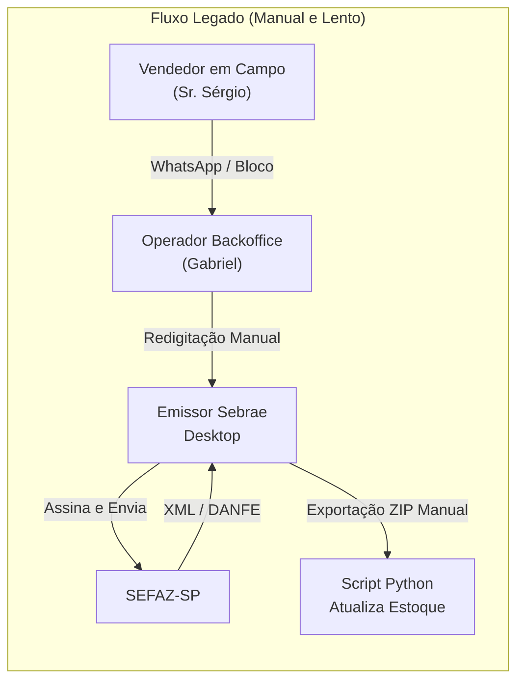
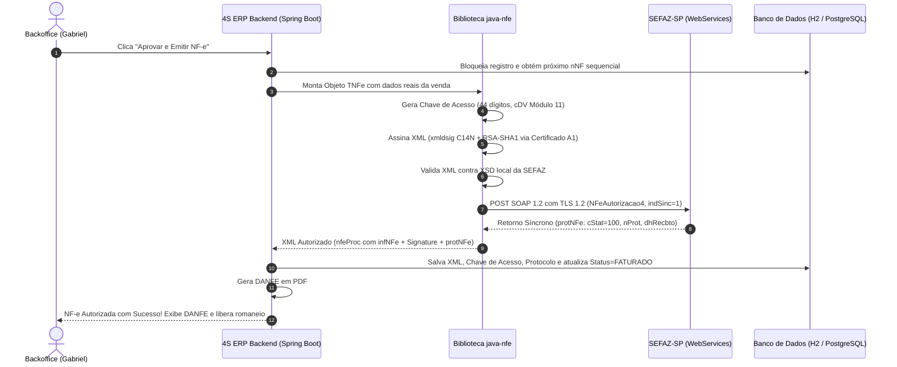
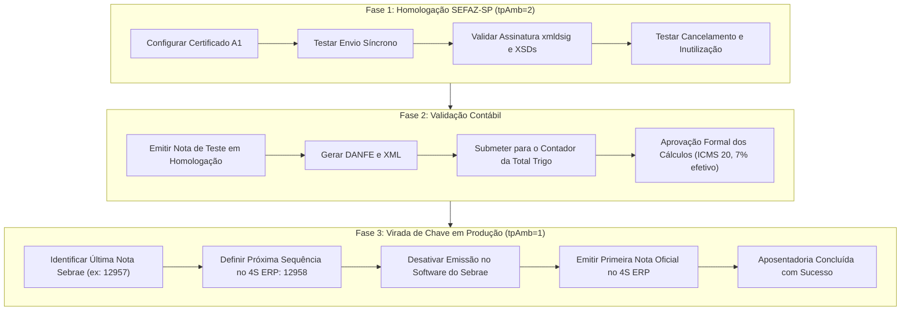

# 📑 Estudo Técnico: Emissão Direta de NF-e 4.00 na SEFAZ-SP com Certificado A1

> **Status**: Validado para Implementação no 4S ERP  
> **Objetivo**: Aposentadoria definitiva do software emissor legado do Sebrae (`verProc: 4.01_sebrae_b053`) e integração direta da autorização de Notas Fiscais Eletrônicas (Modelo 55) ao backend Spring Boot da Total Trigo.  
> **Data de Referência**: Outubro de 2026  
> **Empresa Emissora**: TOTAL TRIGO COMÉRCIO DE ALIMENTOS LTDA (`CNPJ: 09.265.201/0001-95` | `IE: 149.932.895.118` | `CRT: 3`)

---

## 1. Contexto e Motivação do Projeto

Atualmente, a Total Trigo opera com um fluxo fragmentado e dependente do software desktop **Emissor de NF-e do Sebrae** (`versao 4.01_sebrae_b052 / b053`):



### Problemas do Modelo Legado:
1. **Redigitação Humana**: Cada pedido negociado na rua precisa ser redigitado campo a campo no software do Sebrae, gerando risco severo de erros de digitação em CNPJ, razão social, endereço e preços.
2. **Desacoplamento e Gargalo**: O pedido fica represado aguardando operador disponível para abrir o aplicativo desktop, carregar o certificado e emitir a nota.
3. **Falta de API**: O Emissor do Sebrae não possui API REST, banco de dados integrável ou webhooks. A única forma de capturar as emissões para controle de estoque é exportar periodicamente arquivos `.zip` manuais.
4. **Instabilidade do Software Desktop**: Aplicação Java desktop legada que frequentemente trava em lotes maiores e depende de instalação em máquina local específica.

### Objetivo com o 4S ERP:
Permitir que o backoffice (Gabriel), na **Mesa de Pré-Nota**, aprove o pedido com 1 clique e transmita diretamente o XML assinado para a SEFAZ-SP, obtendo o protocolo de autorização (`cStat=100`), gerando o DANFE em PDF e gravando o XML oficial no banco de dados e no storage em menos de 2 segundos.

---

## 2. Comparativo de Arquitetura: Emissão Direta vs. APIs de Mercado

Para viabilizar a emissão no backend Java 21 / Spring Boot 3.4 do 4S ERP, foram avaliadas duas abordagens:

| Critério de Avaliação | Opção 1: Emissão Direta via `java-nfe` (Samuel Oliveira) + Certificado A1 | Opção 2: APIs Terceirizadas SaaS (Nuvem Fiscal / Focus NFe) |
| :--- | :--- | :--- |
| **Custo Mensal Recorrente** | **R$ 0,00 / mês** (Custo Zero) | **R$ 59,00 a R$ 250,00+ / mês** (Planos por faixa de notas) |
| **Certificado Digital Utilizado** | e-CNPJ A1 `.pfx` existente da Total Trigo | e-CNPJ A1 `.pfx` enviado para a nuvem da integradora |
| **Latência e Performance** | Direta com a SEFAZ-SP (~500ms a 1.5s via chamada síncrona) | Duplo salto de rede: App $\to$ API Terceira $\to$ SEFAZ-SP $\to$ API Terceira $\to$ App |
| **Dependência de Terceiros** | Nenhuma (comunicação direta TLS 1.2 com os WebServices SEFAZ-SP) | Dependência contratual, suporte de terceiros e risco de indisponibilidade externa |
| **Privacidade e Segurança** | O certificado `.pfx` e chave privada nunca saem da infraestrutura da Total Trigo | A chave privada e a senha do certificado residem em servidores de terceiros |
| **Complexidade de Implementação** | Média (montagem dos nós XML, assinatura `xmldsig`, gestão de schemas XSD) | Baixa (JSON simples enviado para endpoints REST) |
| **Manutenção Tributária** | Como a Total Trigo opera com apenas **3 SKUs** padronizados e regras fiscais estáveis de SP (CST 20 / Carga 7%), o esforço de manutenção de regras é mínimo | A integradora atualiza schemas de múltiplos estados automaticamente |

### Análise Financeira e Recomendação Estratégica
* **Volume da Total Trigo**: Média de 100 a 300 notas fiscais/mês em rota comercial restrita ao Estado de São Paulo e arredores.
* **Custo das APIs SaaS**:
  * *Nuvem Fiscal*: R$ 69,00/mês para até 150 notas + R$ 0,46 por nota excedente.
  * *Focus NFe*: R$ 89,00 a R$ 190,00/mês para planos intermediários.
* **Decisão Arquitetural**: **Opção 1 (Emissão Direta via `java-nfe`) é a recomendada**.
  * A Total Trigo **já possui Certificado Digital A1 ativo** e válido.
  * O catálogo de produtos é composto por **apenas 3 SKUs**, todos com a mesma regra tributária (ICMS 20 com redução para 7% efetivo, PIS/COFINS NT 09).
  * O custo operacional é **R$ 0,00/mês**, economizando recursos da distribuidora e mantendo o código 100% sob controle e sem intermediários.

---

## 3. Gestão e Ciclo de Vida do Certificado Digital e-CNPJ A1

A Total Trigo possui um certificado digital padrão **ICP-Brasil e-CNPJ A1**, emitido pela autoridade certificadora `AC SAFEWEB RFB v5`:

* **Tipo**: A1 (Software — par de chaves RSA de 2048 bits com certificado digital X.509 v3 gravado em arquivo `.pfx` / `.p12`).
* **Titular**: `TOTAL TRIGO COMERCIO DE ALIMENTOS LTDA:09265201000195`
* **Vantagem Operacional do A1**: Diferente do A3 (token USB ou cartão smartcard que requer intervenção física e drivers legados no Windows), o certificado A1 pode ser carregado programaticamente em memória pelo Spring Boot em qualquer ambiente (Windows, Linux, Docker, Cloud).

### 3.1. Arquitetura de Armazenamento Seguro

Para assegurar conformidade com a LGPD e evitar vazamento da chave privada:

```mermaid
flowchart TD
    subgraph AMBIENTE_LOCAL["Fase Atual (Servidor Local)"]
        CFG1["application.properties / env"] -->|Path + Senha| S1["TOTALTRIGO_NFE_CERT_PATH<br/>TOTALTRIGO_NFE_CERT_PASSWORD"]
        S1 --> B1["Backend Spring Boot<br/>KeyStore.getInstance('PKCS12')"]
    end

    subgraph AMBIENTE_CLOUD["Fase Futura (Google Cloud Platform - GCP)"]
        GSM["Google Secret Manager"] -->|Secret Payload (Base64)| B2["Backend Spring Boot (Cloud Run / GKE)"]
        B2 -->|Leitura in-memory| KM["ByteArrayInputStream (Zero Disk Write)"]
    end
```

1. **Fase Atual (Local)**:
   * O arquivo `.pfx` é armazenado em diretório protegido do sistema operacional com permissões restritas ao usuário de execução do serviço.
   * O caminho absoluto e a senha de descriptografia são injetados exclusivamente por variáveis de ambiente:
     ```properties
     # application.properties (Backend)
     totaltrigo.nfe.cert.path=${TOTALTRIGO_NFE_CERT_PATH:certs/certificado_totaltrigo.pfx}
     totaltrigo.nfe.cert.password=${TOTALTRIGO_NFE_CERT_PASSWORD}
     totaltrigo.nfe.ambiente=${TOTALTRIGO_NFE_AMBIENTE:HOMOLOGACAO} # HOMOLOGACAO ou PRODUCAO
     ```
2. **Fase Cloud (GCP / Google Cloud)**:
   * O binário `.pfx` é codificado em Base64 e armazenado no **Google Secret Manager**.
   * Ao inicializar a aplicação, o Spring Cloud GCP recupera o secret diretamente em memória, eliminando a gravação de arquivos de certificados em contêineres Docker ou discos efêmeros.

### 3.2. Monitoramento de Expiração e Alerta Automático
O backend implementa rotina agendada (`@Scheduled(cron = "0 0 8 * * ?")`) que inspeciona o certificado e emite alertas na tela do backoffice:

```java
public void verificarValidadeCertificado(KeyStore keyStore, String alias) throws Exception {
    X509Certificate cert = (X509Certificate) keyStore.getCertificate(alias);
    LocalDate dataVencimento = cert.getNotAfter().toInstant().atZone(ZoneId.systemDefault()).toLocalDate();
    long diasRestantes = ChronoUnit.DAYS.between(LocalDate.now(), dataVencimento);

    if (diasRestantes <= 30) {
        log.warn("ATENÇÃO: Certificado Digital A1 vence em {} dias (Vencimento: {})!", diasRestantes, dataVencimento);
        // Disparar notificação na interface para o Gabriel providenciar renovação
    }
}
```

---

## 4. Pipeline Técnico de Emissão da NF-e 4.00

O processo de autorização de uma nota fiscal eletrônica segue 5 etapas rigorosas exigidas pelo Manual de Orientação do Contribuinte (MOC 7.0 / NF-e 4.00):



### 4.1. Passo 1: Reserva Atômica da Numeração (`nNF`)
Para evitar quebra de sequência ou duplicidade de notas:
* A série utilizada pela Total Trigo é a **Série 1** (`serie = 1`).
* Conforme verificado nas notas fiscais emitidas no Sebrae:
  * A última nota emitida registrada no sistema foi a de número **`12957`** (lote de outubro de 2026).
  * **O 4S ERP iniciará estritamente na numeração `12958`**, garantindo continuidade fiscal sem interrupção e sem conflitos com notas anteriores.
* O incremento de `nNF` ocorre em transação com isolamento serializável (`SELECT FOR UPDATE`) para que dois operadores nunca gerem o mesmo número simultaneamente.

### 4.2. Passo 2: Montagem da Chave de Acesso (44 Dígitos)
A chave de acesso é composta por:
$$\text{Chave} = \text{cUF (35)} + \text{AAMM (2610)} + \text{CNPJ (09265201000195)} + \text{mod (55)} + \text{serie (001)} + \text{nNF (000012958)} + \text{tpEmis (1)} + \text{cNF (8 dígitos aleatórios)} + \text{cDV (1 dígito módulo 11)}$$

### 4.3. Passo 3: Assinatura Digital do XML (`xmldsig`)
A tag `<infNFe Id="NFe...">` é canonizada via C14N (`http://www.w3.org/TR/2001/REC-xml-c14n-20010315`), resumida com hash SHA-1 e assinada com a chave privada RSA do certificado digital da Total Trigo, gerando a tag `<Signature>` conforme o padrão W3C XML Digital Signature.

### 4.4. Passo 4: Transmissão Síncrona para a SEFAZ-SP
Na NF-e 4.00, a SEFAZ-SP disponibiliza o processamento síncrono para lotes contendo 1 única nota fiscal:
* **Indicador Síncrono**: `<indSinc>1</indSinc>`
* **Vantagem**: A SEFAZ-SP processa a nota e devolve o protocolo de autorização (`<protNFe>`) imediatamente na mesma conexão HTTP. Isso dispensa o antigo fluxo assíncrono de enviar o lote, receber o número do recibo (`nRec`), aguardar alguns segundos e fazer nova consulta de processamento.
* **URLs dos WebServices de SP**:
  * **Homologação (`tpAmb=2`)**: `https://homologacao.nfe.fazenda.sp.gov.br/ws/nfeautorizacao4.asmx`
  * **Produção (`tpAmb=1`)**: `https://nfe.fazenda.sp.gov.br/ws/nfeautorizacao4.asmx`

### 4.5. Passo 5: Geração do Arquivo de Distribuição (`nfeProc`) e DANFE
Quando a SEFAZ retorna `cStat = 100` ("Autorizado o uso da NF-e"), o sistema une o XML assinado da nota com o nó de protocolo retornado, formando o elemento `<nfeProc versao="4.00">`. Esse é o documento fiscal eletrônico oficial que deve ser armazenado por 5 anos e enviado ao cliente e ao contador.

---

## 5. Mapeamento Fiscal Real Validado nos XMLs Oficiais da Total Trigo

Abaixo está o mapeamento exato dos campos obrigatórios, validado diretamente a partir dos arquivos XML de produção da Total Trigo (`3526010926520100019555001000012377...` e lote `NotasJan26`):

### 5.1. Identificação da Nota (`<ide>`)
```xml
<ide>
    <cUF>35</cUF>
    <cNF>00420021</cNF>
    <natOp>VENDA</natOp>
    <mod>55</mod>
    <serie>1</serie>
    <nNF>12958</nNF>
    <dhEmi>2026-10-18T14:30:00-03:00</dhEmi>
    <tpNF>1</tpNF> <!-- 1 = Saída -->
    <idDest>1</idDest> <!-- 1 = Operação interna (SP) -->
    <cMunFG>3550308</cMunFG> <!-- Município IBGE São Paulo -->
    <tpImp>1</tpImp> <!-- 1 = DANFE Retrato -->
    <tpEmis>1</tpEmis> <!-- 1 = Emissão normal -->
    <cDV>X</cDV>
    <tpAmb>1</tpAmb> <!-- 1 = Produção / 2 = Homologação -->
    <finNFe>1</finNFe> <!-- 1 = NF-e normal -->
    <indFinal>1</indFinal> <!-- 1 = Consumidor final / Padaria -->
    <indPres>0</indPres> <!-- 0 = Não se aplica -->
    <procEmi>0</procEmi> <!-- 0 = Emissão de NF-e com aplicativo do contribuinte -->
    <verProc>4S_ERP_1.0</verProc> <!-- Substitui o legado '4.01_sebrae_b053' -->
</ide>
```

### 5.2. Dados do Emitente (`<emit>`)
```xml
<emit>
    <CNPJ>09265201000195</CNPJ>
    <xNome>TOTAL TRIGO COMERCIO ALIMENTOS LTDA</xNome>
    <xFant>TOTAL TRIGO</xFant>
    <enderEmit>
        <xLgr>RUA MARCO AURELIO MARLIANI</xLgr>
        <nro>59</nro>
        <xCpl>SUBSL</xCpl>
        <xBairro>JARDIM ALMEIDA PRADO</xBairro>
        <cMun>3550308</cMun>
        <xMun>Sao Paulo</xMun>
        <UF>SP</UF>
        <CEP>04854170</CEP>
        <cPais>1058</cPais>
        <xPais>BRASIL</xPais>
    </enderEmit>
    <IE>149932895118</IE>
    <IM>59829524</IM>
    <CNAE>4632001</CNAE> <!-- Atacadista de cereais e farinhas -->
    <CRT>3</CRT> <!-- 3 = Regime Normal -->
</emit>
```

### 5.3. Item do Produto e Tributação (`<det>`)
Exemplo real de item faturado:
* **SKU**: Pré-Mistura Pão Doce 25 kg (`SKU-03` / `cProd: 03`)
* **CFOP**: `5102` (Venda no Estado de SP)
* **Unidade Comercial**: `SACAS`
* **Quantidade Faturada (`BQ`)**: 15 sacas
* **Preço Unitário**: R$ 81,34
* **Valor Total do Item**: R$ 1.220,10

```xml
<det nItem="1">
    <prod>
        <cProd>03</cProd>
        <cEAN/>
        <xProd>Farinha de Trigo Pre Mistura Pao Doce 25 Kg</xProd>
        <NCM>11010010</NCM>
        <CFOP>5102</CFOP>
        <uCom>SACAS</uCom>
        <qCom>15.0000</qCom>
        <vUnCom>81.3400000000</vUnCom>
        <vProd>1220.10</vProd>
        <cEANTrib/>
        <uTrib>SACAS</uTrib>
        <qTrib>15.0000</qTrib>
        <vUnTrib>81.3400000000</vUnTrib>
        <indTot>1</indTot>
    </prod>
    <imposto>
        <!-- ICMS com Redução de Base de Cálculo (CST 20) -->
        <ICMS>
            <ICMS20>
                <orig>0</orig> <!-- 0 = Nacional -->
                <CST>20</CST> <!-- Com redução de base de cálculo -->
                <modBC>3</modBC> <!-- 3 = Valor da operação -->
                <pRedBC>58.33</pRedBC> <!-- Redução cadastrada na SEFAZ -->
                <vBC>712.00</vBC> <!-- Base calculada: R$ 1.220,10 * 58,356% = R$ 712,00 -->
                <pICMS>12.0000</pICMS> <!-- Alíquota padrão interna SP: 12% -->
                <vICMS>85.44</vICMS> <!-- R$ 712,00 * 12% = R$ 85,44 (Carga efetiva de 7%) -->
            </ICMS20>
        </ICMS>
        <!-- PIS Não Tributado -->
        <PIS>
            <PISNT>
                <CST>09</CST> <!-- 09 = Operação com Suspensão / Não Tributada -->
            </PISNT>
        </PIS>
        <!-- COFINS Não Tributado -->
        <COFINS>
            <COFINSNT>
                <CST>09</CST> <!-- 09 = Operação com Suspensão / Não Tributada -->
            </COFINSNT>
        </COFINS>
    </imposto>
</det>
```

### 5.4. Pagamento (`<pag>`)
No negócio da Total Trigo, os clientes (padarias e confeitarias) pagam prioritariamente a prazo via boleto bancário (Sicredi):
* **Indicador da Forma de Pagamento (`indPag`)**: `1` (Pagamento a Prazo)
* **Meio de Pagamento (`tPag`)**: `15` (Boleto Bancário)

```xml
<pag>
    <detPag>
        <indPag>1</indPag>
        <tPag>15</tPag>
        <vPag>1220.10</vPag>
    </detPag>
</pag>
```

### 5.5. Informações Complementares Obrigatórias (`<infAdic>`)
Por exigência do RICMS/SP, o benefício de redução da cesta básica/farinhas deve ser expresso no campo de dados adicionais:
```xml
<infAdic>
    <infCpl>REDUCAO DE 7% ANEXO III ARTIGO 3 DO RICMS</infCpl>
</infAdic>
```

---

## 6. Implementação Prática no Backend Java (Spring Boot + `java-nfe`)

### 6.1. Dependência no `pom.xml`
A biblioteca mantida por Samuel Oliveira (`java-nfe`) é a mais madura e utilizada no ecossistema Java para comunicação com as SEFAZs:

```xml
<dependency>
    <groupId>com.github.samueldias</groupId>
    <artifactId>java-nfe</artifactId>
    <version>4.00.28</version>
</dependency>
```

### 6.2. Classe de Configuração do Certificado e Ambiente
```java
package br.com.totaltrigo.erp.infrastructure.fiscal.nfe;

import br.com.swconsultoria.nfe.dom.ConfiguracoesIniciaisNfe;
import br.com.swconsultoria.nfe.dom.enuns.AmbienteEnum;
import br.com.swconsultoria.nfe.dom.enuns.EstadosEnum;
import br.com.swconsultoria.certificado.Certificado;
import br.com.swconsultoria.certificado.CertificadoService;
import org.springframework.beans.factory.annotation.Value;
import org.springframework.context.annotation.Bean;
import org.springframework.context.annotation.Configuration;

import java.io.FileInputStream;
import java.io.InputStream;

@Configuration
public class NfeConfig {

    @Value("${totaltrigo.nfe.cert.path}")
    private String certPath;

    @Value("${totaltrigo.nfe.cert.password}")
    private String certPassword;

    @Value("${totaltrigo.nfe.ambiente:HOMOLOGACAO}")
    private String ambienteConfig;

    @Bean
    public ConfiguracoesIniciaisNfe configuracoesNfe() throws Exception {
        // Carrega o certificado A1 .pfx da Total Trigo
        Certificado certificado;
        try (InputStream certStream = new FileInputStream(certPath)) {
            certificado = CertificadoService.certificadoPfx(certStream, certPassword);
        }

        AmbienteEnum ambiente = "PRODUCAO".equalsIgnoreCase(ambienteConfig) 
                ? AmbienteEnum.PRODUCAO 
                : AmbienteEnum.HOMOLOGACAO;

        // Inicializa as configurações para o Estado de São Paulo
        return ConfiguracoesIniciaisNfe.iniciaConfiguracoes(
                EstadosEnum.SP,
                ambiente,
                certificado,
                "schemas/nfe", // Diretório local dos arquivos XSD oficiais da SEFAZ
                false          // Validação assíncrona desativada
        );
    }
}
```

### 6.3. Serviço de Emissão e Transmissão Síncrona
```java
package br.com.totaltrigo.erp.infrastructure.fiscal.nfe;

import br.com.swconsultoria.nfe.Nfe;
import br.com.swconsultoria.nfe.dom.ConfiguracoesIniciaisNfe;
import br.com.swconsultoria.nfe.dom.enuns.StatusEnum;
import br.com.swconsultoria.nfe.schema_4.enviNFe.*;
import br.com.swconsultoria.nfe.schema_4.retEnviNFe.TRetEnviNFe;
import br.com.totaltrigo.erp.domain.model.Order;
import org.springframework.stereotype.Service;
import org.springframework.transaction.annotation.Transactional;

@Service
public class SefazNfeEmissionService {

    private final ConfiguracoesIniciaisNfe nfeConfig;
    private final NfeXmlBuilder xmlBuilder;
    private final NfeDanfeService danfeService;

    public SefazNfeEmissionService(ConfiguracoesIniciaisNfe nfeConfig,
                                   NfeXmlBuilder xmlBuilder,
                                   NfeDanfeService danfeService) {
        this.nfeConfig = nfeConfig;
        this.xmlBuilder = xmlBuilder;
        this.danfeService = danfeService;
    }

    @Transactional
    public NfeEmissionResult emitirNfe(Order order, Long numeroNFe) throws Exception {
        // 1. Monta o XML da NF-e com os dados cadastrais e fiscais da Total Trigo
        TNFe nfe = xmlBuilder.construirNfe(order, numeroNFe);

        // 2. Monta o lote para envio síncrono (1 nota por lote)
        TEnviNFe enviNFe = new TEnviNFe();
        enviNFe.setVersao("4.00");
        enviNFe.setIdLote("1");
        enviNFe.setIndSinc("1"); // 1 = Síncrono (Processamento Imediato SEFAZ-SP)
        enviNFe.getNFe().add(nfe);

        // 3. Monta e Assina Digitalmente o Lote com o Certificado A1
        enviNFe = Nfe.montaLote(nfeConfig, enviNFe);

        // 4. Envia para o WebService da SEFAZ-SP
        TRetEnviNFe retorno = Nfe.enviarNfe(nfeConfig, enviNFe, null);

        // 5. Avalia o retorno síncrono
        if (StatusEnum.LOTE_PROCESSADO.getCodigo().equals(retorno.getCStat())) {
            var protNFe = retorno.getProtNFe();
            String cStat = protNFe.getInfProt().getCStat();

            if (StatusEnum.AUTORIZADO.getCodigo().equals(cStat)) {
                // Sucesso: cStat 100
                String xmlDistribuicao = Nfe.criaProcNfe(nfeConfig, enviNFe, protNFe);
                String chaveAcesso = protNFe.getInfProt().getChNFe();
                String protocolo = protNFe.getInfProt().getNProt();

                // Gera o DANFE em PDF
                byte[] danfePdf = danfeService.gerarDanfePdf(xmlDistribuicao);

                return new NfeEmissionResult(true, chaveAcesso, protocolo, xmlDistribuicao, danfePdf, null);
            } else {
                // Rejeição específica da nota (ex: 204, 539, etc.)
                String motivo = protNFe.getInfProt().getXMotivo();
                return new NfeEmissionResult(false, null, null, null, null, "Rejeição SEFAZ (" + cStat + "): " + motivo);
            }
        }

        return new NfeEmissionResult(false, null, null, null, null, "Erro no Lote: " + retorno.getXMotivo());
    }
}
```

---

## 7. Roteiro de Transição e Cutover (Aposentadoria do Sebrae)

Para garantir segurança jurídica e continuidade fiscal, a migração do Emissor do Sebrae para o 4S ERP será executada em **3 fases**:



### Checklist do Dia do Cutover:
1. Fechar o expediente do software do Sebrae e gerar backup de exportação final de todos os XMLs emitidos.
2. Confirmar o número da última nota fiscal autorizada (exemplo: `12957`).
3. Cadastrar no banco de dados do 4S ERP o valor inicial do contador: `last_nfe_number = 12957` e `serie = 1`.
4. Habilitar a flag `totaltrigo.nfe.ambiente=PRODUCAO` no backend.
5. Gabriel emite o primeiro pedido de rua aprovado no 4S ERP, gerando a nota **`12958`**.
6. Verificar a autorização no portal nacional da NF-e e imprimir o DANFE diretamente no painel.
