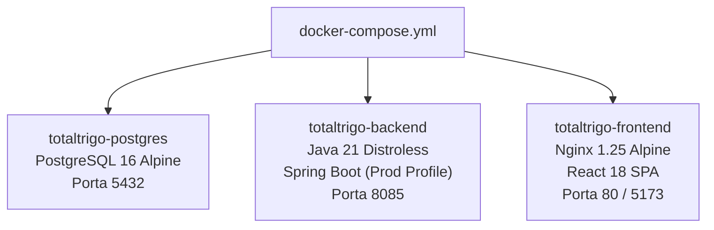

# 🚀 Guia de Implantação e Desenvolvimento — TotalTrigo

Este guia fornece as instruções técnicas para desenvolvedores, suporte e operadores instalarem, configurarem e executarem os módulos do ecossistema **TotalTrigo / 4S ERP**, tanto em ambiente de desenvolvimento ágil quanto em produção com Docker e PostgreSQL.

---

## 💻 Pré-Requisitos de Ambiente

Para executar todo o ecossistema localmente, certifique-se de dispor dos seguintes binários:

| Tecnologia | Versão Mínima | Finalidade | Verificação no Terminal |
| :--- | :---: | :--- | :--- |
| **Java JDK** | 21 LTS | Backend Spring Boot 3.4 | `java -version` |
| **Apache Maven** | 3.9+ | Build e testes do Backend | `mvn -v` |
| **Node.js & npm** | Node 18+ / npm 9+ | Frontend React + Vite + Tailwind | `node -v` e `npm -v` |
| **Docker & Compose** | Docker 24+ / Compose v2 | Ambiente de Produção Containerizado | `docker --version` |
| **Python** | 3.10+ | Módulo de Automação de Planilha | `python --version` |

---

## ⚡ Inicialização Rápida para Desenvolvimento (1 Clique)

O repositório inclui um script em lote para subir toda a aplicação em ambiente de desenvolvimento local:

```text
iniciar_sistema.bat
```

### O que o script executa:
1. Abre uma janela de terminal e inicia a **API Spring Boot** na porta `8085` usando o banco H2 local em arquivo (`./data/totaltrigo_db`).
2. O **Flyway** executa automaticamente as migrações:
   * `V1__init_schema.sql`: Tabelas fundamentais de produtos, clientes e pedidos.
   * `V2__seed_data.sql`: Carga inicial de padarias de SP, lotes de importação e pedidos semente.
   * `V3__dq_bq_and_dual_stock.sql`: Criação de `base_stock`, coluna `dispatch_quantity` (DQ) e frete oficial R$ 4,00/saca.
   * `V4__crud_receivables_audit_auth.sql`: Criação das tabelas `receivable_titles` (boletos BQ) e `audit_logs` (trilha de auditoria).
3. Abre uma segunda janela de terminal e inicia o **Frontend Vite** na porta `5173`.
4. Aguarda a subida dos servidores e abre o navegador automaticamente em:
   ```text
   http://localhost:5173
   ```

---

## 🔧 Execução Manual dos Componentes

### 1. Backend (Spring Boot 3)
```powershell
cd backend
mvn spring-boot:run
```
* **Porta HTTP**: `8085`
* **Console do Banco H2**: `http://localhost:8085/h2-console`
  * **Driver Class**: `org.h2.Driver`
  * **JDBC URL**: `jdbc:h2:file:./data/totaltrigo_db;DB_CLOSE_DELAY=-1;AUTO_SERVER=TRUE`
  * **User Name**: `sa`
  * **Password**: *(em branco)*
* **Suíte de Testes Automatizados**:
  ```powershell
  mvn test
  ```
  Executa os testes unitários de cálculo de margem (DQ/BQ), rateio de frete e serviços fiscais (`FiscalDocumentServiceTest`, `BackofficeServiceTest`).

### 2. Frontend (React 18 + Vite)
```powershell
cd frontend
npm install
npm run dev
```
* **Acesso Web**: `http://localhost:5173`
* **Executar Testes Unitários**:
  ```powershell
  npm run test
  ```
* **Compilar para Produção (Build)**:
  ```powershell
  npm run build
  ```

### 3. Módulo de Automação de Planilha (Python)
```powershell
cd automacao-planilha
.\executar.bat
```
Ou com o interpretador Python diretamente:
```powershell
..\.venv\Scripts\activate
python atualizar_estoque.py
```

---

## 🐳 Implantação em Produção com Docker Compose

Para ambientes de homologação ou produção corporativa, o sistema conta com orquestração completa em contêineres e banco **PostgreSQL 16**:



### Comandos de Implantação:
```bash
# Subir todo o ambiente em segundo plano
docker compose up --build -d

# Verificar saúde dos serviços
docker compose ps

# Visualizar logs da API
docker compose logs -f totaltrigo-backend
```

### Variáveis de Ambiente de Produção (`application-prod.yml`):
* `SPRING_DATASOURCE_URL`: `jdbc:postgresql://totaltrigo-postgres:5432/totaltrigo_prod`
* `SPRING_DATASOURCE_USERNAME`: `totaltrigo_user`
* `SPRING_DATASOURCE_PASSWORD`: `${DB_PASSWORD}`
* `SPRING_FLYWAY_ENABLED`: `true`

---

## 💾 Rotinas Automatizadas de Backup

O diretório `backend/` dispõe de scripts para cópia de segurança com rotação diária de 30 dias:

### Windows (PowerShell / Batch)
```powershell
cd backend
.\backup_db.bat
```
* Gera o arquivo compactado `backend/backups/totaltrigo_backup_YYYYMMDD_HHMMSS.sql.gz`.
* Realiza a expurgo automático de arquivos com mais de 30 dias de retenção.

### Linux (Bash / Cron Job)
```bash
cd backend
chmod +x backup_db.sh
./backup_db.sh
```
* Recomendado agendar no `crontab` para execução diária às 02:00:
  ```text
  0 2 * * * /caminho/TotalTrigo/backend/backup_db.sh >> /var/log/totaltrigo_backup.log 2>&1
  ```

---

## 📂 Estrutura de Diretórios Atualizada

```text
TotalTrigo/
│
├── backend/                             # API Spring Boot 3.4 (Java 21)
│   ├── src/main/java/                   # Controllers, Domain Model, Repositories, Services
│   │   └── br/com/totaltrigo/erp/
│   │       ├── controller/              # Backoffice, FieldSales, FiscalDocument, ManagementExtension
│   │       ├── domain/model/            # Product, Order, OrderItem, ReceivableTitle, AuditLog...
│   │       └── service/                 # FiscalDocumentService, SpreadsheetSyncService...
│   ├── src/main/resources/
│   │   ├── application.yml              # Perfil Dev (H2 Local)
│   │   ├── application-prod.yml         # Perfil Prod (PostgreSQL 16)
│   │   └── db/migration/                # Flyway V1, V2, V3, V4
│   ├── backups/                         # Diretório de dumps do banco de dados
│   ├── backup_db.bat / .sh              # Scripts de backup rotativo
│   ├── Dockerfile                       # Multi-stage build Java 21
│   └── pom.xml                          # Maven POM com suíte JUnit 5
│
├── frontend/                            # Interface Web React 18 + TypeScript + Vite
│   ├── src/lib/                         # business.ts (cálculos de margem DQ/BQ), documentPrint.ts
│   ├── src/routes/                      # index.tsx (6 módulos backoffice, seletor de perfis)
│   ├── src/test/                        # business.test.ts (Vitest)
│   ├── public/sw.js                     # PWA Service Worker (fila offline)
│   ├── Dockerfile                       # Multi-stage build Nginx Alpine
│   └── package.json                     # Scripts e dependências npm
│
├── automacao-planilha/                  # Automação de Estoque via XML
│   ├── Planilha de Estoques.xlsx        # Planilha Excel de trabalho
│   ├── atualizar_estoque.py             # Script de processamento aberto
│   ├── notas/                           # XMLs faturados recebidos do ERP
│   └── backups/                         # Backups de segurança da planilha
│
├── docs/                                # Documentação Técnica e Operacional
│   ├── index.html                       # Hub Central de Documentação 4S ERP
│   ├── ARQUITETURA_DO_SISTEMA.md/.html
│   ├── MANUAL_OPERACIONAL_ERP.md/.html
│   ├── REGRAS_DE_NEGOCIO_E_FISCAL.md/.html
│   ├── ESTUDO_TECNICO_NFE_SEFAZ_A1.md/.html
│   ├── ESTUDO_TECNICO_API_SICREDI.md/.html
│   ├── MANUAL_DE_USO_PLANILHA.md/.html
│   ├── GUIA_DE_IMPLANTACAO_E_DESENVOLVIMENTO.md/.html
│   └── PRD_E_ARQUITETURA_EXPANSAO.md/.html
│
├── docker-compose.yml                   # Orquestração do Backend, Frontend e PostgreSQL
├── iniciar_sistema.bat                  # Script de inicialização dev 1 clique
└── README.md                            # Sumário geral do projeto
```

---

## 🛠️ Dicas e Troubleshooting

### Portas 8085 ou 5173 Ocupadas
```powershell
netstat -ano | findstr :8085
taskkill /PID <PID> /F
```

### Limpeza de Dados de Desenvolvimento
Caso deseje resetar o banco de dados H2 para reaplicar o seed padrão das migrações Flyway:
1. Encerre o terminal do Backend.
2. Exclua a pasta `backend/data/` (ou os arquivos `totaltrigo_db.mv.db`).
3. Ao reiniciar o backend, o Flyway aplicará `V1` a `V4` novamente.
