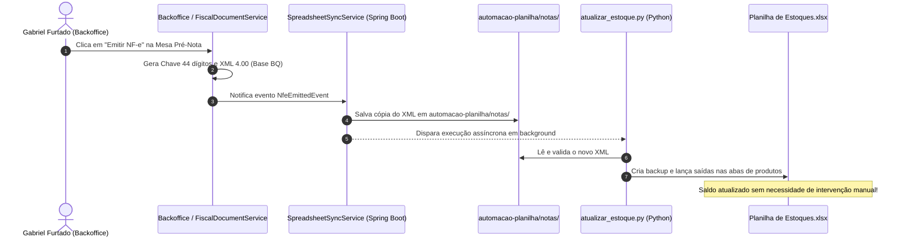

# 📊 Manual de Uso e Operação — Automação da Planilha de Estoques

Este manual detalha o funcionamento, as regras de negócio contábeis e as instruções de uso diário do módulo **`automacao-planilha/`**, responsável por sincronizar automaticamente as notas fiscais eletrônicas (NF-e) com a **`Planilha de Estoques.xlsx`**.

---

## 🎯 Objetivo da Automação

Substituir o trabalho manual de digitação de saídas de estoque no Excel. O sistema lê diretamente os arquivos XML (distribuição nacional NF-e 4.00) ou pacotes ZIP, identifica os itens faturados, mapeia para as abas correspondentes e insere as saídas com fórmulas dinâmicas de saldo, preservando a integridade contábil da Total Trigo.

---

## 🔄 Sincronização Automática via ERP (`SpreadsheetSyncService`)

A partir da versão integrada com o Backoffice TotalTrigo, o processo de exportação tornou-se **100% automático**:



> [!TIP]
> A execução manual via `executar.bat` descrita abaixo continua totalmente disponível e é o método recomendado para notas fiscais legadas ou pacotes ZIP mensais fornecidos pela contabilidade.

---

## 🗂️ Estrutura de Arquivos do Módulo (`automacao-planilha/`)

```text
automacao-planilha/
│
├── Planilha de Estoques.xlsx      # Arquivo oficial de estoque em operação
├── executar.bat                   # Atalho de dois cliques para execução no Windows
├── config.json                    # Regras de mapeamento e diretórios configuráveis
│
├── atualizar_estoque.py           # Script principal (orquestrador e interface visual Rich)
├── excel_updater.py               # Manipulador da planilha (openpyxl, fórmulas e abas)
├── nfe_parser.py                  # Parser de XML NF-e (extração de chaves, itens, valores)
├── zip_manager.py                 # Extrator automático de pacotes ZIP de notas
│
├── notas/                         # Pasta onde os arquivos .xml devem ser depositados (ou salvos pelo ERP)
├── zips/                          # Pasta opcional para pacotes .zip de notas baixadas
├── backups/                       # Histórico de backups automáticos pré-execução
└── README.md                      # Resumo rápido para o operador
```

---

## 🚀 Como Usar no Dia a Dia (Modo Manual em Lote)

### Passo 1: Depositar os Arquivos de Notas
1. Baixe os arquivos XML emitidos no período (do portal da SEFAZ, Focus NF-e, Nuvem Fiscal ou software emissor).
2. Você pode:
   * Colocar os arquivos `.xml` diretamente na pasta **`automacao-planilha/notas/`**; OU
   * Colocar o arquivo comprimido `.zip` na pasta **`automacao-planilha/zips/`** (o sistema extrai os XMLs automaticamente).

### Passo 2: Fechar a Planilha no Excel
> [!IMPORTANT]
> Feche o arquivo `Planilha de Estoques.xlsx` antes de rodar a automação. Se a planilha estiver aberta no Microsoft Excel, o Windows bloqueará a gravação (`PermissionError`).

### Passo 3: Executar a Automação
1. Dê dois cliques no arquivo:
   ```text
   automacao-planilha/executar.bat
   ```
2. O terminal abrirá automaticamente com uma interface visual estilizada:
   * **Descompactação**: Localiza e descompacta arquivos ZIP novos.
   * **Varredura**: Lê e valida todos os arquivos XML da pasta `notas/`.
   * **Validação de Mês**: Checa se o mês das notas já possui cabeçalho na planilha.
   * **Backup Automático**: Cria uma cópia íntegra em `backups/` com data e hora.
   * **Lançamentos**: Preenche as saídas e aplica as fórmulas de saldo.
   * **Relatório**: Exibe uma tabela com o resumo de itens processados, notas ignoradas por duplicidade e saldo final de cada aba.

---

## 📑 Regras de Negócio e Mapeamento de Produtos

### 1. Mapeamento Automático de Abas
O parser avalia o código do produto na nota fiscal (`cProd`) e as palavras-chave na descrição (`xProd`):

| Aba na Planilha | Códigos na NF-e | Palavras-Chave Identificadoras | Critérios de Exclusão |
| :--- | :--- | :--- | :--- |
| **`FARINHA DE TRIGO`** | `05`, `5`, `0000200000001` | `tipo 1`, `tipo1`, `farinha de trigo tipo 1` | Nenhum |
| **`PRE MISTURA`** | `02`, `2`, `PA02980502603` | `pre mistura`, `pré mistura` | Exclui palavras como `pao doce`, `pão doce` |
| **`PM PAO DOCE`** | `03`, `3`, `0002960502503` | `pao doce`, `pão doce`, `mistura pao doce` | Nenhum |

### 2. Multi-Itens por Nota Fiscal
* **Produtos Mistos**: Se uma única nota fiscal faturar, por exemplo, 50 sacas de Farinha Tipo 1 e 20 sacas de Pré-Mistura, a automação separa os itens e lança 50 sacas na aba `FARINHA DE TRIGO` e 20 sacas na aba `PRE MISTURA`, ambas referenciando o mesmo número de NF e mesma data.
* **Múltiplos Lotes do Mesmo Produto**: Se houver mais de uma linha na NF com o mesmo produto (lotes distintos ou preços diferentes), ambas são lançadas sequencialmente na mesma aba.

### 3. Colunas Atualizadas na Planilha
Cada linha inserida abaixo do mês corrente segue o padrão:

| Coluna | Campo | Tipo de Dado | Regra de Preenchimento |
| :---: | :--- | :--- | :--- |
| **A** | **Data** | Data (`mm-dd-yy`) | Data de emissão da NF-e (`dhEmi` ou `dEmi`). Formato de data real do Excel. |
| **B** | **N.F.** | Inteiro | Número da nota fiscal (`nNF`). Ex: `12377`. |
| **C** | **Preço Unitário** | Decimal | Valor unitário praticado na nota (`vUnCom`). |
| **D** | *(Vazio)* | — | Reservado conforme layout original da planilha. |
| **E** | *(Vazio)* | — | Reservado conforme layout original da planilha. |
| **F** | **Entrada** | Decimal | Mantido em branco para lançamentos de venda. |
| **G** | **Saída** | Inteiro / Decimal | Quantidade faturada (`qCom`). Ex: `100`. |
| **H** | **Saldo** | Fórmula Excel | Fórmula dinâmica: `=H{linha_anterior}-G{linha_atual}`. |

---

## 🔒 Mecanismos de Proteção e Segurança

### 1. Prevenção de Lançamentos Duplicados (Idempotência)
Antes de inserir qualquer linha, o robô inspeciona as notas fiscais já existentes na coluna `B` da respectiva aba. Se o número da nota já constar nos registros daquele mês, o lançamento é **ignorado** e um aviso em amarelo é exibido no terminal. Isso permite rodar a automação várias vezes na mesma pasta sem risco de duplicar saídas.

### 2. Proteção de Saldo Inicial e Validação de Mês
O script impede a corrupção do saldo do estoque:
* Se as notas forem de um mês novo (ex: Outubro) e a planilha estiver preenchida apenas até Setembro, o script **interrompe a gravação com um alerta amigável**:
  > *"O cabeçalho do mês 10/2026 ainda não foi criado na planilha. Abra a planilha, crie a seção do novo mês e digite o saldo inicial antes de rodar a automação."*
* Isso assegura que o operador humano sempre declare conscientemente a contagem física / saldo transportado antes de qualquer débito automático.

### 3. Política de Backups Automáticos
* **Cópia Original Intacta**: Mantida em `backups/Planilha de Estoques - ORIGINAL 2026-10-12.xlsx`.
* **Backup Pré-Gravação**: A cada execução com notas válidas novas, um snapshot com carimbo de tempo é criado automaticamente em `backups/Planilha de Estoques - BACKUP YYYY-MM-DD_HHMMSS.xlsx`.

---

## ⚙️ Configuração Personalizada (`config.json`)

Você pode ajustar parâmetros operacionais sem mexer no código Python através de `automacao-planilha/config.json`:

```json
{
  "caminho_planilha": "Planilha de Estoques.xlsx",
  "pasta_notas": "notas",
  "pasta_backups": "backups",
  "pastas_zips": ["zips", "notas", "."],
  "mapeamento_abas": [
    {
      "aba": "FARINHA DE TRIGO",
      "codigos": ["05", "5"],
      "palavras_chave": ["tipo 1", "tipo1", "farinha de trigo tipo 1"]
    },
    {
      "aba": "PRE MISTURA",
      "codigos": ["02", "2"],
      "palavras_chave": ["pre mistura", "pré mistura"],
      "palavras_excluidas": ["doce", "pao doce", "pão doce"]
    },
    {
      "aba": "PM PAO DOCE",
      "codigos": ["03", "3"],
      "palavras_chave": ["pao doce", "pão doce"]
    }
  ]
}
```

---

## ❓ Resolução de Problemas (Troubleshooting)

### Erro: `PermissionError: [Errno 13] Permission denied: 'Planilha de Estoques.xlsx'`
* **Causa**: O arquivo Excel está aberto no seu computador ou por outro usuário na rede local.
* **Solução**: Salve e feche o Excel, em seguida rode o `executar.bat` novamente.

### Aviso: `Nenhuma nota nova encontrada para lançar`
* **Causa**: Todos os XMLs presentes na pasta `notas/` já foram lançados previamente na planilha.
* **Solução**: Se você tem notas novas, certifique-se de que salvou os novos arquivos `.xml` dentro da pasta `notas/`.

### Como Restaurar uma Versão Anterior
Caso queira desfazer lançamentos de uma execução:
1. Abra a pasta `automacao-planilha/backups/`.
2. Localize o arquivo gerado imediatamente antes da execução (verifique a data e hora no nome do arquivo).
3. Renomeie esse backup para `Planilha de Estoques.xlsx` e mova-o para a pasta `automacao-planilha/`, substituindo o arquivo atual.
