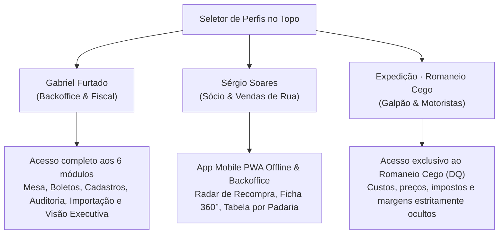
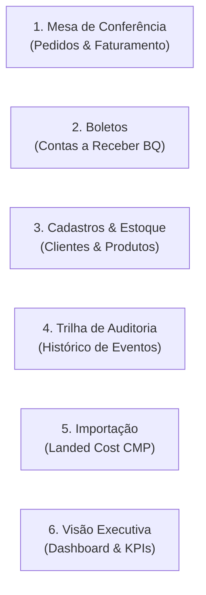

# 🖥️ Manual Operacional do ERP — TotalTrigo Web

Este manual orienta a operação prática do **TotalTrigo / 4S ERP**, cobrindo o aplicativo móvel de vendas de campo (utilizado pelo **Sr. Sérgio**) e os 6 módulos integrados do painel de retaguarda desktop (operado pelo **Gabriel Furtado** e pela equipe de **Expedição**).

---

## 👥 Perfis de Acesso e Alternância Rápida

O sistema possui 3 perfis operacionais com controle de visualização granular no seletor do topo:

* **Gabriel Furtado · Backoffice & Fiscal**: Operação completa de retaguarda, aprovação pré-nota, emissão de NF-e, controle de boletos, trilha de auditoria e parametrização de importação.
* **Sérgio Soares · Sócio & Rua**: Operação em campo com PWA offline e visão estratégica no notebook.
* **Expedição · Romaneio Cego**: Interface simplificada para operadores de empilhadeira e separadores no galpão, garantindo sigilo comercial absoluto.

---

## 🔍 Acessibilidade e Ergonomia em Campo (Escala de Fontes)

No cabeçalho superior direito, tanto no celular quanto no desktop, há o seletor rápido de escala tipográfica:
* **A (Normal)**: 100% do tamanho base (padrão de interface moderna).
* **A+ (Grande)**: +15% no corpo do texto e botões, facilitando leitura em tablets.
* **A++ (Extra Grande)**: +30% no contraste e tamanho, ideal para operação em celulares sob luz solar direta no balcão da padaria.
* A preferência fica gravada no dispositivo local (`localStorage.getItem('totaltrigo_font_scale')`).

---

## 📱 Módulo Mobile: Vendas de Campo (Sr. Sérgio)

### 1. Radar de Recompra & PWA com Fila Offline
* **Funcionamento Offline**: Através do Service Worker (`sw.js`), se a padaria estiver sem sinal de operadora 4G/5G, o pedido é salvo na fila local do dispositivo. Assim que a conexão for restabelecida, o sistema envia automaticamente para o backend (`FieldSalesService`).
* **Radar Inteligente de Recompra**:
  * O sistema analisa o ciclo médio de consumo de cada padaria.
  * Padarias com ciclo estourado (ex: compra habitual a cada 15 dias, já se passaram 18 dias) ganham destaque imediato no topo da lista.
* **Semáforo Financeiro**:
  * 🟢 **Em Dia**: Cliente liberado para novos pedidos.
  * 🔴 **Boleto Vencido**: Alerta sonoro/visual para alinhamento amigável antes de emitir nova carga.

### 2. Ficha 360º do Cliente
* **Histórico de Preços por SKU**: Apresenta a memória de preços acordada no último pedido para Farinha Tipo 1, Pré-Mistura e Pão Doce.
* **Caderno de Notas Operacionais**: Campo dinâmico para instruções como horários de recebimento, preferências do padeiro e restrições de caminhão.
* **Pré-Cadastro Rápido por CNPJ**:
  * Botão **"+ Pré-Cadastro por CNPJ"**.
  * Preenchimento automático via **BrasilAPI** (Razão Social, Nome Fantasia, Bairro, CEP e Código IBGE 7 dígitos).

### 3. Lançador de Pedidos com Proteção Anti-Curioso
* **Seleção em Sacas (25kg)**: Inserção facilitada por botões rápidos (+5, +10, +50 sacas).
* **Card de Margem Ocultável**: Os números de custo landed, frete por saca e margem líquida ficam recolhidos por padrão para que o cliente não veja a rentabilidade da TotalTrigo no balcão. O vendedor toca para expandir quando estiver sozinho.
* **Reserva de Estoque Imediata**: Ao clicar em **"Finalizar Pedido"**, o status torna-se `AGUARDANDO_REVISAO` e o estoque é reservado no galpão (`reservedStock`).

---

## 💻 Módulo Desktop: Backoffice Integrado (Gabriel)

O painel de retaguarda conta com **6 abas especializadas**:

### 1. Mesa de Conferência Pré-Nota (`orders`)
* **Análise de Margem com Farol Visual**:
  * 🟢 **Margem Saudável (≥ 20%)**: Pedido rentável e liberado para faturamento.
  * 🟡 **Margem Atenção (7% a 20%)**: Requer conferência do Gabriel sobre descontos comerciais concedidos.
  * 🔴 **Margem Crítica (< 7%)**: Venda com risco de prejuízo operacional após impostos (8% ICMS/Simples) e frete (R$ 4,00/saca).
* **Desacoplamento DQ vs BQ**:
  * Permite ajustar a **Qtd. Expedição (DQ)** física a ser entregue e a **Qtd. Base (BQ)** tributada na nota fiscal.
* **Impressão de Documentos Fiscais**:
  * **DANFE de Retenção**: Impressão visual com dados completos, produtos faturados por BQ, base de cálculo e chave de acesso oficial.
  * **Romaneio Cego**: Documento limpo com quantidades físicas DQ, instrução de descarregamento e comprovante de canhoto de entrega.
* **Eventos Fiscais**: Geração de Carta de Correção Eletrônica (CC-e) e Registro de Devolução Total ou Parcial.

### 2. Boletos & Contas a Receber (`receivables`)
* **Geração Baseada Estritamente na BQ**: Nenhum boleto é gerado sobre sacas de bonificação ou volumes além da base fiscal faturada.
* **Prazos Operacionais**: Suporte nativo a faturamento em 28 dias ou parcelamento semanal (ex: 14 e 28 dias).
* **Gestão de Baixas**: Baixa manual de títulos quitados com registro do operador e data de pagamento.
* **Controle de Inadimplência**: Padarias com títulos vencidos têm status automaticamente sinalizado como `BOLETO_VENCIDO`.

### 3. Cadastros & Estoque (`registrations`)
* **Visão Tripla de Estoque**: Exibição em tempo real do Estoque Físico (`physical_stock`), Reservado (`reserved_stock`), Disponível (`available_stock`) e Saldo Base Acumulado (`base_stock`).
* **Enriquecimento Cadastral**: Botão de busca imediata na Receita Federal via BrasilAPI para novos clientes e validação de Inscrição Estadual.

### 4. Trilha de Auditoria (`audit`)
* **Registro Imutável de Operações**:
  * Gravação automática de eventos críticos: `ENTRADA_LOTE_IMPORTACAO`, `EMISSAO_NFE`, `PEDIDO_NOVO`, `BAIXA_TITULO_RECEBIVEL`, `AJUSTE_FISCAL`.
  * Identificação do operador responsável (Gabriel Furtado ou Sérgio Soares), timestamp exato e resumo da alteração.

### 5. Importação & Landed Cost CMP (`import`)
* **Entrada de Carreta de Trigo**:
  * Lançamento de lotes da Argentina/Uruguai com cotação PTAX, FOB USD, Frete Internacional e Despesas Aduaneiras.
  * Na entrada do lote de importação nacionalizado: **$\text{BQ} = \text{DQ}$**.
* **Recálculo do CMP**:
  * O sistema atualiza o Custo Médio Ponderado dos SKUs instantaneamente:
  $$\text{Novo CMP} = \frac{(\text{Estoque Antigo} \times \text{CMP Antigo}) + (\text{Qtd Lote} \times \text{Custo Lote})}{\text{Estoque Antigo} + \text{Qtd Lote}}$$

### 6. Visão Executiva (`executive`)
* **KPIs Estratégicos**:
  * Faturamento bruto mensal faturado (Base BQ);
  * Margem de contribuição líquida consolidada (%);
  * Volume físico expedido em sacas (DQ);
  * Custo total de frete apurado ($\sum \text{DQ} \times \text{R\$}~4{,}00$);
  * Índice de pontualidade de recebíveis e saldo a liquidar.
