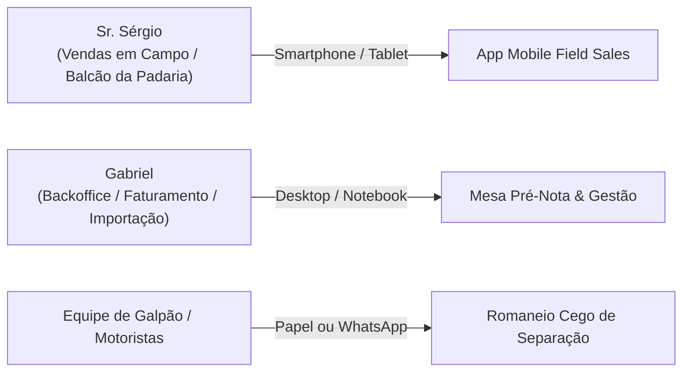

# 🖥️ Manual Operacional do ERP — TotalTrigo Web

Este manual orienta a utilização das interfaces operacionais da plataforma web do **TotalTrigo ERP**, contemplando o módulo móvel para vendas de campo (utilizado pelo **Sr. Sérgio**) e o painel de retaguarda de faturamento e estoque (operado pelo **Gabriel**).

---

## 👥 Personas e Perfis de Acesso

---

## 📱 Módulo 1: App Mobile Field Sales (Sr. Sérgio)

Projetado para telas de celular, com ergonomia para operação em pé no balcão da padaria, toques largos e alta densidade de informação útil.

### 1. Radar de Recompra e Agenda de Hoje (Tela 1)
* **Visitas Agendadas**: Lista prioritária de clientes roteirizados para o dia.
* **Radar Inteligente de Recompra**: Sinaliza automaticamente padarias que ultrapassaram seu ciclo habitual de compras (ex: média de compra a cada 20 dias, porém sem compras há 22 dias).
* **Semáforo Financeiro**:
  * 🟢 **Em dia**: Cliente apto para novos pedidos.
  * 🔴 **1 boleto vencido**: Alerta para cobrança cordial antes de fechar novo lote.
* **Pré-Cadastro Rápido por CNPJ**:
  * Ao visitar um cliente novo, clique no botão **"+ Pré-Cadastro por CNPJ"**.
  * Digite apenas o CNPJ (14 dígitos) e clique em **Buscar**.
  * O sistema consulta a Receita Federal via **BrasilAPI**, preenche Razão Social, Fantasia, Endereço e Código IBGE em segundos.

### 2. Ficha 360º do Cliente (Tela 2)
* **Memória de Preço por SKU**: Mostra instantaneamente o último preço praticado para Farinha Tipo 1, Pré-Mistura e Pão Doce, evitando divergências na negociação.
* **Caderno de Notas da Visita**: Campo para anotações operacionais rápidas (ex: *"Dono viaja na quinta, prefere entrega às terças pela manhã"*).
* **Condição de Pagamento Padrão**: Exibe os prazos combinados (ex: *Boleto 28 dias* ou *Semanal 7/14/21/28 dias*).

### 3. Lançador de Pedidos com Proteção de Margem (Tela 3)
* **Seleção dos 3 SKUs**: Adicione quantidades em sacas de 25 kg com botões de incremento rápido (+5, +10, +50).
* **Ajuste de Preço**: O vendedor pode negociar o preço unitário mantendo a coerência com a tabela base.
* **Privacidade de Margem (Anti-Curioso)**:
  * O breakdown de custos (Custo Landed, Frete por Saco, Impostos e Lucro Líquido Real) permanece **oculto por padrão**.
  * O vendedor pode expandir o card com um único toque quando o cliente não estiver olhando para a tela, verificando a rentabilidade da venda.
* **Conclusão**: Ao clicar em **"Finalizar Pedido"**, o pedido entra no sistema com o status `AGUARDANDO_REVISAO` e o estoque correspondente é imediatamente bloqueado no galpão como `reservedStock`.

---

## 💻 Módulo 2: Mesa de Conferência Pré-Nota (Gabriel)

Painel desktop de alta produtividade voltado para validação cadastral, conciliação fiscal e faturamento.

### 1. Mesa de Pedidos em Tempo Real
Exibe os pedidos enviados da rua organizados por ordem de chegada:
* **Semáforo de Prontidão Fiscal**:
  * 🟢 **Pronto para Faturar**: CNPJ válido, Inscrição Estadual preenchida e Código IBGE 7 dígitos presente.
  * 🟡 **Cadastro Incompleto**: Falta IE ou Código IBGE. O botão **"Completar Cadastro Fiscal"** dispara a busca automática na BrasilAPI para enriquecer a ficha em 1 clique.

### 2. Ajuste Comercial vs. Fiscal
> [!NOTE]
> Muitas vezes a negociação na rua difere do faturamento fiscal por questões de fatiamento de lotes ou acertos tributários.
* A mesa permite que o Gabriel edite a quantidade ou o valor unitário da **Nota Fiscal** sem apagar o **Pedido Comercial Original da Rua**.
* Fica registrado o histórico completo de quem ajustou, quando e a justificativa fiscal.

### 3. Emissão do Romaneio Cego de Separação
* Ao avançar o pedido para `EM_SEPARACAO`, o sistema permite gerar o **Romaneio Cego**.
* O documento omite intencionalmente valores em reais, margens de lucro e dados fiscais, exibindo estritamente:
  * Nome do Cliente e Endereço de Entrega;
  * Quantidade exata de sacas de cada SKU (25kg);
  * Instruções especiais para o motorista (ex: *"Descarregar nos fundos"*).

### 4. Transmissão e Emissão da NF-e
* Ao clicar em **"Emitir NF-e"**:
  1. O sistema valida os campos obrigatórios da SEFAZ SP.
  2. Gera a **Chave de Acesso de 44 dígitos** (com verificação módulo 11).
  3. Gera o arquivo **XML 4.00** compatível.
  4. Executa a baixa definitiva no estoque físico (`physicalStock`).
  5. Atualiza o status do pedido para `FATURADO`.

---

## 🚢 Módulo 3: Calculadora de Landed Cost (Lotes de Importação)

Módulo dedicado à precificação e rateio de carretas de trigo importadas da Argentina/Uruguai:

1. **Parâmetros de Entrada do Lote**:
   * Cotação PTAX USD do dia do desembaraço;
   * Valor FOB Total em Dólares;
   * Frete Internacional Rodoviário / Marítimo em Reais;
   * Impostos de Importação (II, PIS/COFINS Importação, AFRMM);
   * Despesas Aduaneiras e Honorários de Despachante.
2. **Rateio Automático**:
   * O sistema rateia proporcionalmente o custo entre os sacos de Farinha Tipo 1, Pré-Mistura e Pão Doce importados.
3. **Atualização do Custo Médio**:
   * O sistema calcula o novo `currentLandedCost` unitário e recalcula os alertas de margem de lucro mínima praticáveis pelo time de vendas.
