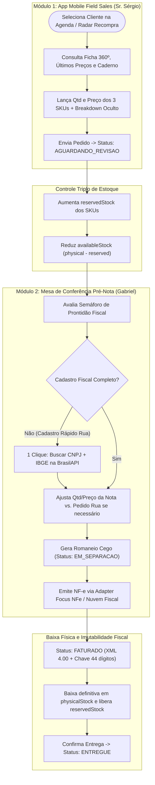

# Documento de Engenharia de Requisitos, PRD e Arquitetura de Expansão — TotalTrigo ERP

> **Empresa**: TOTAL TRIGO COMERCIO DE ALIMENTOS LTDA  
> **CNPJ**: 09.265.201/0001-95 | IE: 149.932.895.118 | Regime Tributário: Normal (`CRT=3` — ICMS CST 20 com Redução de BC de 41,67%, carga efetiva 7% Anexo III Art. 3 RICMS-SP + IBS/CBS)  
> **Sede**: Rua Marco Aurélio Marliani, 59 - Jardim Almeida Prado, São Paulo - SP (IBGE `3550308`)

---

## 1. Catálogo Oficial dos 3 SKUs Importados
| SKU # | Código NF-e (`cProd`) | Descrição Oficial na SEFAZ | NCM | CEST / cBenef | CFOP Int/Ext | Unidade |
| :--- | :--- | :--- | :--- | :--- | :--- | :--- |
| **SKU-05** | `0000200000001` (`05`) | Farinha de Trigo Tipo 1 25Kg | `11010010` | `1704400` / `SP020390` | `5102` / `6102` | `SA` (25kg) |
| **SKU-02** | `PA02980502603` (`02`) | Farinha de Trigo Pré-Mistura 25Kg | `11010010` | `1704600` / `SP020390` | `5102` / `6102` | `SA` (25kg) |
| **SKU-03** | `0002960502503` (`03`) | Pré-Mistura Pão Doce 25Kg | `11010010` | `1704600` / `SP020390` | `5102` / `6102` | `SA` (25kg) |

---

## 2. Personas & Jobs-to-be-Done (JTBD)

### [P01] Sr. Sérgio — Sócio-Fundador e Vendedor Field Sales (Na Rua)
- **JTBD 1 (Memória de Preço e Velocidade)**: *Quando* estou no balcão da padaria negociando com o cliente, *quero* abrir a ficha 360º, ver na hora o último preço praticado nos 3 SKUs, as anotações da última visita e lançar o pedido em poucos toques, *para* fechar a venda em segundos sem depender de cadernos de papel.
- **JTBD 2 (Privacidade de Margem)**: *Quando* o cliente está ao meu lado olhando para o celular, *quero* que o breakdown de lucro líquido e custo do lote de importação fique oculto por padrão e expansível com 1 toque, *para* proteger a margem da Total Trigo.

### [P02] Gabriel — Gestor de Backoffice Fiscal, Financeiro e Importação (Escritório)
- **JTBD 1 (Mesa de Conferência Pré-Nota e Ajuste Comercial vs. Fiscal)**: *Quando* um pedido chega da rua em `AGUARDANDO_REVISAO`, *quero* revisar a prontidão fiscal do cliente (consultando CNPJ e IBGE na BrasilAPI em 1 clique) e poder ajustar a quantidade ou o valor unitário que vai efetivamente para a Nota Fiscal sem perder o histórico do pedido comercial original, *para* evitar rejeições na SEFAZ e adequar o faturamento às condições combinadas.
- **JTBD 2 (Calculadora de Landed Cost)**: *Quando* chega uma nova carreta/lote de importação, *quero* ratear câmbio, FOB USD, frete internacional, impostos e despachante entre os 3 SKUs, *para* atualizar automaticamente o estoque físico e o custo internalizado (`currentLandedCost`).

### [P03] Equipe de Galpão & Motoristas
- **JTBD 1 (Romaneio Cego)**: *Quando* o pedido é liberado para separação (`EM_SEPARACAO`), *quero* receber no WhatsApp ou impresso o Romaneio de Separação e Entrega limpo (sem preços nem margens), *para* carregar os sacos de 25kg certos e entregar no horário combinado.

---

## 3. Modelagem BPMN 2.0 (To-Be)

---

## 4. Roadmap de Expansão Futura
1. **Fase 1 (Entregue nesta Release)**:
   - Backend Spring Boot + JPA + Flyway + H2/PostgreSQL com Máquina de Estados rigorosa e Estoque Triplo.
   - Integração com **BrasilAPI** e **ViaCEP** para preenchimento automático de CNPJ, Razão Social, Endereço e Código IBGE (7 dígitos).
   - Adapter Fiscal (`NfeGatewayPort`) gerando chave de acesso de 44 dígitos e XML NF-e 4.00 compatível com o padrão real da Total Trigo e com o parser Python (`nfe_parser.py`).
   - Frontend React + TypeScript + Tailwind com App Mobile (3 abas), Mesa de Conferência Pré-Nota, Calculadora de Lote de Importação e Estúdio de Temas Visuais (4 propostas de design).
2. **Fase 2 (Sincronização Automatizada com Planilha e Contabilidade)**:
   - Ao emitir a NF-e no Backoffice, salvar opcionalmente uma cópia do XML diretamente na pasta `notas/` e acionar o `excel_updater.py` para manter a `Planilha de Estoques.xlsx` 100% sincronizada durante a transição.
3. **Fase 3 (Roteirização Zona Sul SP, Contas a Receber e Canhoto Digital)**:
   - Agrupamento automático de entregas por bairro (Grajaú, Parelheiros, Cidade Ademar, Jabaquara, Campo Belo, Santo André).
   - Controle de vencimento de boletos que alimenta automaticamente a flag `BOLETO_VENCIDO` na Ficha 360º do cliente.
